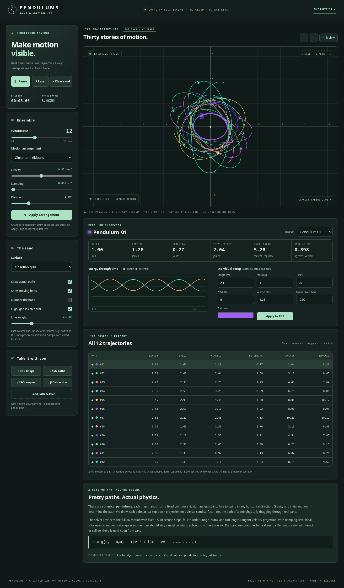
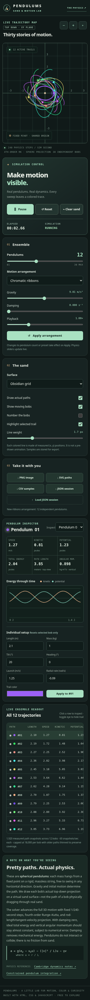

# Pendulums — Sand & Motion Lab

A free, offline sandbox that draws measured pendulum motion in an interactive **XYZ studio** and a **top-down trajectory map**. Up to **30 independent spherical pendulums** share a fixed pivot. Gravity, launch conditions, string length, and damping determine every trail.

Choose from nine ensemble arrangements, explore 360 whole-degree release headings, give individual bobs persistent physical overrides, and preserve drawings as layered artwork. Inspect speed, energy, vertical angular momentum, and projected travel distance while the simulation runs.

**[Open the live sandbox](https://mitchell-d00.github.io/Pendulums/)** — no installation required.

## Start locally

1. [Download the repository ZIP](https://github.com/mitchell-d00/Pendulums/archive/refs/heads/main.zip) and extract it, or clone the repository.
2. Keep the files together and open `index.html` in a modern browser with Canvas 2D support.
3. The simulation starts running with 12 bobs in **Chromatic ribbons**. Use **Pause** to inspect or edit it.

There is no build step, package installation, API key, external asset, or internet requirement after downloading. The application uses plain HTML, CSS, and JavaScript; even the 3D view is drawn with Canvas 2D.

For local HTTP serving, if preferred:

```sh
cd Pendulums
python3 -m http.server 8000
```

Open <http://localhost:8000>. For static hosting, deploy the repository root with all three JavaScript files and both stylesheets. On GitHub Pages, select **Settings → Pages → Deploy from a branch → main → / (root)**. See [development and deployment](docs/DEVELOPMENT.md).

## What you can do

| Area | Current behavior |
|---|---|
| Ensemble | Choose 1–30 bobs, one of nine arrangements, and a 0–359° release heading; press either **Apply arrangement** button. |
| Live physics | Change gravity, ensemble damping, or playback without restarting. Individual damping overrides take priority over ensemble damping. |
| Individual path mode | In **Make it yours**, select a bob, choose a recipe or edit its values, and apply. Only that bob restarts. |
| Persistent overrides | Individual settings survive ensemble Apply for bobs still present. **Reset selected to ensemble** explicitly returns one bob to the current ensemble. |
| XYZ studio | Orbit, pan, zoom, switch Top/3D/Side/Under views, recolor paths, and save up to eight measured art layers. |
| Top-down map | View XY paths on Obsidian grid, Warm sand, or Graph paper; inspect each bob and its energy history. |
| Export | Download top-down PNG/SVG, measured CSV, physics-session JSON, 3D PNG, or separate layered-art JSON. |

**Ensemble Apply restarts the simulation.** It preserves individual configurations, not ongoing positions or unsaved live tracks. Keep **Keep previous artwork on new patterns** checked to archive the drawing in the XYZ studio before Apply, Reset, or Clear sand. Individual Apply has its own **Preserve this bob's previous trail** option. Export files before closing or reloading the page; there is no automatic session persistence.

## Guides

- [User guide](docs/USER_GUIDE.md) — controls, arrangements, individual overrides, cameras, and artwork.
- [Physics and numerical model](docs/PHYSICS.md) — equations, units, damping, sampling, and limitations.
- [Exports and saved-file formats](docs/FILE_FORMATS.md) — what each download contains and restores.
- [Development, testing, and deployment](docs/DEVELOPMENT.md) — source map, prerequisites, all suites, and hosting checks.
- [Contributing](CONTRIBUTING.md) — changes, verification, and bug reports.

## Physics at a glance

A fourth-order Runge–Kutta solver advances each bob at **240 fixed steps per simulated second**, projecting position to its fixed-length sphere and velocity to its tangent plane. Trails record actual XYZ positions at **60 samples per simulated second**. Up to **18,000 samples per bob** are retained; older samples are progressively thinned when the limit is exceeded.

Mass changes energy and angular momentum, but not isolated ideal motion. Bobs do not collide, the virtual sand applies no force, and cameras and colors do not affect physics. Undamped energy and vertical angular momentum are approximately conserved, subject to numerical error. [Read the model and references](docs/PHYSICS.md).

## Verification

With Node.js 18 or later, run all four Node suites explicitly, including the damping regression whose filename is not `*.test.cjs`:

```sh
node --test tests/physics.test.cjs tests/patterns.test.cjs tests/studio3d.test.cjs tests/physics_damping_regression.cjs
```

The six Python browser suites require Playwright and Chromium at `/usr/bin/chromium`. They test locally injected source at desktop and phone sizes, rather than a deployed site. See [complete test commands and coverage](docs/DEVELOPMENT.md#testing). Run the suites against your checkout; historical development pass counts are not current verification.

## Screenshots

The bundled screenshots show an earlier interface; use the guides above for the current XYZ studio and individual-override workflow.




## License

[MIT](LICENSE). Free to use and remix; retain the license notice when redistributing the software.
